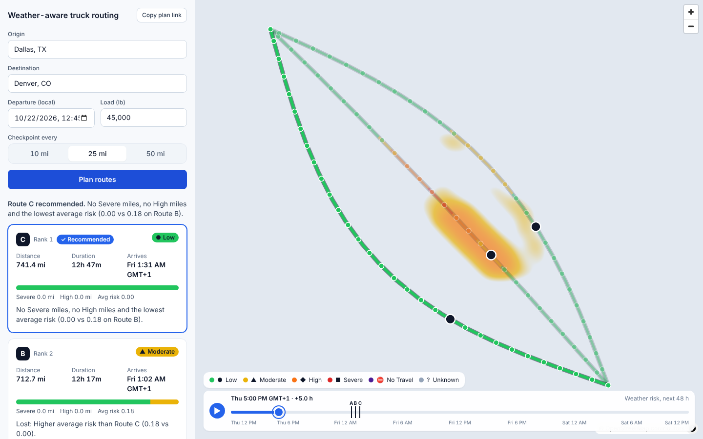
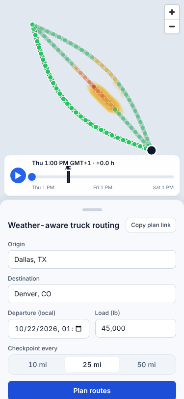

# Weather-Aware Truck Routing

Plan a truck trip and get **three route options ranked by safety**. Each route gets a checkpoint
every 10, 25 or 50 miles. Each checkpoint's **ETA** is estimated, and the forecast for that hour is
classified against wind, rain and snow thresholds plus **load-weight rules**. The safest route
is recommended (fewest Severe miles → fewest High miles → lowest average risk → shortest time),
and every route, checkpoint and risk level is shown on a map with a **0–48 h weather heatmap**
and moving truck markers. Every plan has a shareable URL.

- **Web app:** `https://truck-web.vercel.app` _(set after deploying; see [Deploy](#deploy-to-vercel))_
- **API docs:** `https://truck-api.vercel.app/api/docs/`
- **Walkthrough (Loom):** _to record; script in [`docs/loom-script.md`](docs/loom-script.md)_

| Desktop: heatmap at +5 h, truck B inside the storm | Phone: bottom sheet + slider |
| --- | --- |
|  |  |

_Screenshots use the test-only fake providers; map tiles were blocked in the build sandbox._

## Quick start

```bash
cp backend/.env.example backend/.env        # add TOMTOM_API_KEY (and ORS_API_KEY if you have one)
docker compose up --build                   # Postgres 16, Redis 7, API :8000, web :5173
open http://localhost:5173
```

No keys yet? Run with the deterministic fake providers (test-only, refused when `DEBUG=False`):
`PROVIDERS_MODE=fake docker compose up`.

### Manual setup

```bash
# API (Python 3.12)
cd backend
python3.12 -m venv .venv && . .venv/bin/activate
pip install ".[dev]"
export DATABASE_URL=sqlite:///db.sqlite3 PROVIDERS_MODE=fake   # or Postgres + real keys
python manage.py migrate && python manage.py runserver

# Web (Node 20+)
cd frontend
npm ci
VITE_API_BASE_URL=http://localhost:8000 npm run dev
```

## Architecture

```text
 Browser ── React 18 SPA (Vite, TS strict) ─────────────────────────────────────────┐
   │  TanStack Query · zustand UI store · MapLibre GL (lazy chunk) · GSAP           │
   │  slider → hour bus → setPaintProperty (no React renders while scrubbing)       │
   ▼                                                                                │
 Django 5 + DRF  /api/v1   (Vercel Function or gunicorn)                            │
   ├─ trips/       build_plan: routes → checkpoints + ETA → weather at ETA          │
   │               → risk → segments/metrics → ranking + reasons → TripPlan          │
   ├─ risk/        pure rules + engine + metrics (no Django imports)                │
   ├─ providers/   TomTom routing ⇄ ORS fallback · TomTom search ⇄ Nominatim        │
   │               Open-Meteo hourly · retries + circuit breakers                    │
   ├─ Postgres     TripPlan(result JSONB, heatmap JSONB, expires_at)                 │
   └─ Redis        geocode 24 h · routes 15 min · weather 30 min · throttles          │
                                                                                     │
 Provider keys stay server-side; the browser only talks to /api ◄────────────────────┘
```

## Risk rules as implemented

Bands include their lower bound and exclude the upper bound, except rain and snow **No Travel,
which begins strictly above** 1.00 / 3.00 in/hr (so Severe includes 1.00 and 3.00). Values are
not rounded before classification, and negative inputs clamp to 0.

| Condition | Low | Moderate | High | Severe | No Travel |
| --- | --- | --- | --- | --- | --- |
| Wind mph (sustained) | < 25 | 25 ≤ w < 35 | 35 ≤ w < 45 | 45 ≤ w < 55 | ≥ 55 |
| Rain in/hr | < 0.10 | 0.10 ≤ r < 0.25 | 0.25 ≤ r < 0.50 | 0.50 ≤ r ≤ 1.00 | > 1.00 |
| Snow in/hr | < 0.5 | 0.5 ≤ s < 1.0 | 1.0 ≤ s < 2.0 | 2.0 ≤ s ≤ 3.0 | > 3.0 |

**Load rules** (wind only; they never lower a level): ≥ 55 mph → No Travel for any load;
45 ≤ w < 55 with load > 30,000 lb → No Travel; 35 ≤ w < 45 with load > 40,000 lb → Severe.
A checkpoint's level is the worst of wind (after load rules), rain and snow; the drawer shows
which component(s) drove it and the load rule text verbatim.

- **Segments:** the stretch between two checkpoints takes the **worse** endpoint level. With one
  endpoint Unknown, it takes the known level only if that is ≥ High, otherwise it is Unknown.
- **Unknown is never Low:** it is excluded from the average, counted as its own miles, and a route
  with more than 20% unknown miles gets a `LOW_FORECAST_COVERAGE` warning.
- **Weather at ETA (Open-Meteo):**
  - `wind_speed_10m` is instantaneous, so it is interpolated between the two hours around the ETA.
  - `rain`, `showers`, `snowfall` and gusts are sums or maxima over the **preceding** hour, so the
    hour containing the ETA is labelled `ceil(ETA)`. The drawer shows this as "forecast hour used".
  - Gusts are displayed but never used to set the level.
  - **Deviation from the brief:** the rain rate is `rain + showers`, because Open-Meteo reports
    convective downpours under `showers`. See [`docs/provider-notes.md`](docs/provider-notes.md).

## Ranking

```text
key = (no_travel_miles > 0,   # gate: any No Travel ranks below every route without it
       no_travel_miles, severe_miles, high_miles,   # 0.1 mi precision
       avg_risk (2 dp, unknown → 99), travel_time_s, label)
```

`recommended` is `null` when every route has No Travel miles ("No route is safe to drive at
this departure time."). Each losing route explains the **first** criterion where it differs
from the winner, using the same rounded numbers as its card. Worked example (load 45,000 lb,
25 mi; a required test):

| Route | Time | Severe mi | High mi | Avg | Rank | Explanation |
| --- | --- | --- | --- | --- | --- | --- |
| B | 7h05 | 0 | 10.0 | 0.81 | 1 | "No Severe miles and the fewest High miles (10.0 vs 25.0 on Route A)." |
| A | 6h40 | 0 | 25.0 | 0.62 | 2 | "15.0 more High miles than Route B (25.0 vs 10.0)." |
| C | 6h20 | 12.5 | 0 | 0.40 | 3 | "12.5 more Severe miles than Route B (12.5 vs 0.0)." |

## API

Interactive docs at **`/api/docs/`** (ReDoc at `/api/redoc/`, schema at `/api/schema/`).

| Method + path | |
| --- | --- |
| `GET /api/v1/geocode/?q=` | ≥ 3 chars, ≤ 6 `{label, lat, lon}`, cached 24 h |
| `POST /api/v1/plans/` | body below → `201` full plan |
| `GET /api/v1/plans/{id}/` | `404 PLAN_NOT_FOUND` if missing or expired (7 days) |
| `GET /api/v1/plans/{id}/heatmap/` | corridor grid × 49 h; computed once, then stored |
| `GET /api/v1/risk-rules/` | thresholds, load rules, colours, scores (drives the legend) |
| `GET /api/health/` | `{status, providers: {tomtom, ors}}` |

```bash
curl -X POST http://localhost:8000/api/v1/plans/ -H 'Content-Type: application/json' -d '{
  "origin": {"label": "Dallas, TX", "lat": 32.7767, "lon": -96.797},
  "destination": {"label": "Denver, CO", "lat": 39.7392, "lon": -104.9903},
  "departure": "2026-10-23T13:00:00Z", "load_lb": 45000, "interval_mi": 25}'
```

Errors always look like `{"error": {"code", "message", "field"}}`. The codes are
`VALIDATION_ERROR`, `SAME_LOCATION`, `DEPARTURE_OUT_OF_RANGE`, `ROUTE_NOT_FOUND` (422),
`ROUTING_UNAVAILABLE` (503), `PLAN_NOT_FOUND` (404) and `RATE_LIMITED` (429 + `Retry-After`).

## Performance notes

- **The slider never re-renders React.**
  - The heatmap's 49 hourly scores (`h0…h48` per grid point) are uploaded **once**.
  - Scrubbing writes the hour to an imperative bus, and one `requestAnimationFrame` per frame
    cross-fades `heatmap-weight` between two hours with `setPaintProperty`, moves the three truck
    markers, and updates the slider's DOM.
  - React state is committed only on pointer-up or a key press.
  - A Playwright test counts React commits through a dev-only `<Profiler>`: **0 while dragging,
    0 while playing** ([`docs/perf`](docs/perf/README.md)).
- **Hover and selection** change paint properties and `feature-state` only, so geometry is never
  re-uploaded.
- **Bundle:** the main chunk is 141 KB gzip (budget 180 KB), and `maplibre-gl` is a lazy chunk.
  Lighthouse desktop on the planner page scores Performance 90–93 and Accessibility 100
  ([`docs/perf/lighthouse.md`](docs/perf/lighthouse.md)).
- Route geometry is simplified for display (Douglas–Peucker, 0.0005°); full resolution is used
  only for checkpoint sampling.

## Assumptions and limits

- **Forecast resolution:** Open-Meteo's model grid is ~1–11 km and hourly, and coordinates are
  rounded to 0.01° and de-duplicated. Forecasts end at 16 days; checkpoints beyond the horizon
  are Unknown.
- **Interval coarseness:** weather between checkpoints is inferred from the endpoints (worse
  endpoint wins), so a 50 mi interval can miss a narrow storm cell. Use 10 mi for detail.
- **Routing:**
  - TomTom truck routing uses `vehicleWeight` (kg), live traffic and the departure time. A
    departure at or before "now" is sent without `departAt`.
  - OpenRouteService (fallback) has no departure time or traffic, and only offers alternatives
    for short trips (~100 km). Longer trips get alternatives from via-point requests.
  - Fewer than three routes are shown only when no distinct alternatives exist; a route is never
    invented.
- **Quotas:** TomTom's free tier limits daily requests. Every provider call is cached (routes
  15 min, weather 30 min, geocoding 24 h) and rate-limited per IP.
- **Cold starts on Vercel:** the first request after idle loads Django (~1–2 s).
- **Route labels:** routes are labelled A, B, C by ascending travel time (spec §6.4). The worked
  example above keeps the spec's own labels.

## Testing

```bash
# API: ruff, mypy (strict), pytest with coverage, OpenAPI validation
cd backend
ruff check . && ruff format --check . && mypy .
pytest --cov=risk --cov=trips --cov=providers --cov-fail-under=85
python manage.py spectacular --validate --fail-on-warn --file /tmp/schema.yml

# Web: eslint, tsc, vitest, build
cd frontend
npm run lint && npm run typecheck && npm test && npm run build

# End-to-end (API running with PROVIDERS_MODE=fake, DEBUG on)
VITE_API_BASE_URL=http://localhost:8000 npx playwright test
```

- **Backend:** 256 tests, ~97% coverage, 100% on `risk/` and the core `trips/` modules.
  - **Boundary tests:** every threshold edge at −0.01 / edge / +0.01 in all three tables
    (113 risk cases); the load rules at 29,999 / 30,000 / 30,001 lb and 39,999 / 40,000 /
    40,001 lb; load rules never lowering a rain- or snow-driven level.
  - **Weather and ranking:** preceding-hour precipitation semantics, wind interpolation,
    beyond-horizon Unknown, each ranking criterion deciding alone, the No Travel gate, and the
    worked example.
  - **Property tests:** monotonic ETAs, destination ETA equal to the provider total, and risk
    miles summing to the route distance.
  - **Providers:** `respx` tests for TomTom, ORS, Open-Meteo and Nominatim, plus retries, the
    circuit breaker and fallback.
- **Frontend:** 33 vitest tests (gradient stops, truck position, hour bus, formatters, zod
  schema) and 5 Playwright tests (full plan flow and drawer, zero renders while scrubbing,
  reduced motion, phone sheet).

## Deploy to Vercel

The API and the web app deploy as two Vercel projects from this repo (Root Directory `backend`
and `frontend`). The step-by-step guide, environment variables, Neon Postgres, cron and smoke
test are in **[`docs/deploy-vercel.md`](docs/deploy-vercel.md)**. Both projects were verified with
`vercel build`.
